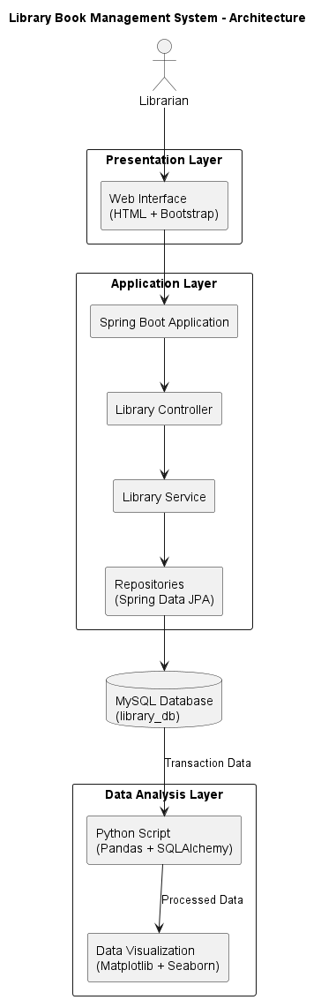
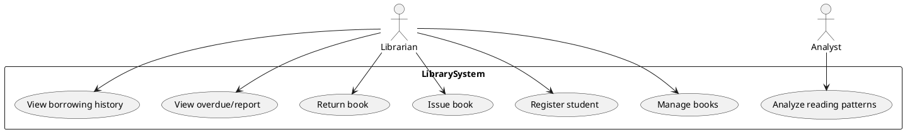
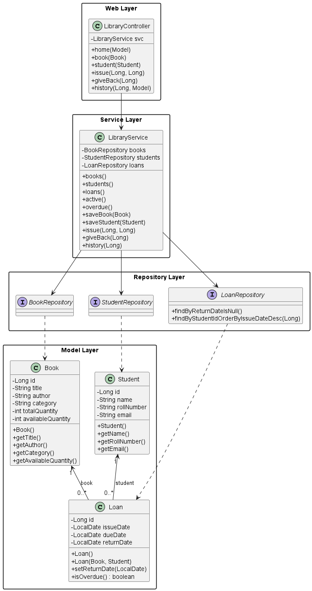
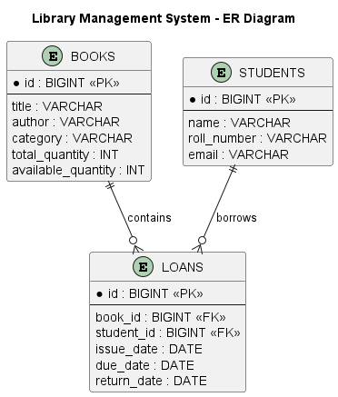

# Design and Diagrams
## Architecture

Browser (HTML/Bootstrap + Thymeleaf) → Spring MVC Controller → LibraryService (business rules) → Spring Data JPA → MySQL. Python → SQLAlchemy/PyMySQL → MySQL → Pandas → Matplotlib/Seaborn.
## Use case diagram (PlantUML)


## Class diagram (PlantUML)

```plantuml
@startuml
class Book {id; title; author; category; totalQuantity; availableQuantity}
class Student {id; name; rollNumber; email}
class Loan {id; issueDate; dueDate; returnDate; isOverdue()}
class LibraryService {books(); students(); issue(); giveBack(); overdue(); history()}
Book "1" -- "0..*" Loan
Student "1" -- "0..*" Loan
LibraryService ..> Book
LibraryService ..> Student
LibraryService ..> Loan
@enduml
```
## ER diagram (PlantUML)

```plantuml
@startuml
entity BOOK { *id : BIGINT
 title : VARCHAR
 author : VARCHAR
 category : VARCHAR
 total_quantity : INT
 available_quantity : INT }
entity STUDENT { *id : BIGINT
 name : VARCHAR
 roll_number : VARCHAR
 email : VARCHAR }
entity LOAN { *id : BIGINT
 book_id : BIGINT
 student_id : BIGINT
 issue_date : DATE
 due_date : DATE
 return_date : DATE }
BOOK ||--o{ LOAN
STUDENT ||--o{ LOAN
@enduml
```
## Relational model
BOOKS(id PK, title, author, category, total_quantity, available_quantity)

STUDENTS(id PK, name, roll_number UNIQUE, email UNIQUE)

LOANS(id PK, book_id FK, student_id FK, issue_date, due_date, return_date)
BOOK(**id**, title, author, category, total_quantity, available_quantity)
STUDENT(**id**, name, roll_number UNIQUE, email UNIQUE)
LOAN(**id**, book_id FK, student_id FK, issue_date, due_date, return_date)
## Normalization
1NF: All attributes contain atomic values, with no repeating groups.

2NF: Every non-key attribute depends on the complete primary key.

3NF: Book and student details are stored separately from loan records, reducing data duplication and avoiding transitive dependencies.
1NF: atomic values, no repeating groups. 2NF: each relation has a single-column key; every non-key attribute depends on its complete key. 3NF: student and book details are separated from loan facts, avoiding transitive dependencies and repeated descriptive data.
